# Conditional VAE vs GAN on MNIST: Quality, Coverage, Control, and Efficiency

Experiment started: 2026-10-10 17:53 (Asia/Shanghai). This report was generated from saved model weights and evaluation results. The dataset is MNIST, and the generative models are this repository's existing conditional convolutional VAE and conditional DCGAN. The formal study comprises 6 training runs with random seeds 42, 43, and 44.

## 1. Main results: two separate training budgets

The table reports the mean ± **sample standard deviation** (ddof=1) across independent training seeds. Standard deviations accompanying percentages are expressed in percentage points. Higher condition accuracy, precision, and recall are better; lower MMD² is better. Training time is measured in seconds. Error bars describe variation across training seeds, not confidence intervals.

| Checkpoint | Condition accuracy ↑ | MMD² ↓ | Distribution precision ↑ | Distribution recall ↑ | Cumulative training seconds |
| --- | --- | --- | --- | --- | --- |
| VAE20 | 89.32 ± 0.35% | 3589.6 ± 62 | 71.70 ± 0.40% | 54.00 ± 1.33% | 26.12 ± 0.11 |
| GAN20 | 99.92 ± 0.02% | 442.79 ± 113 | 73.98 ± 1.02% | 43.43 ± 2.36% | 60.96 ± 0.57 |
| GAN50 | 99.94 ± 0.01% | 300.65 ± 96.8 | 80.76 ± 1.14% | 51.02 ± 4.32% | 152.10 ± 1.36 |

For the comparison at 20 epochs, the direct answer is: **GAN20 has higher condition accuracy and lower feature-distribution MMD²; VAE20 has higher coverage recall, trains faster, and generates images at higher throughput.** These findings concern different measurement axes. Numerical results and evidence for each seed are retained below, so an advantage on one axis is not treated as superiority in every respect.

At 20 epochs, different models lead on precision and recall, revealing a practical tradeoff between indications of quality and coverage. The proximity of generated images to the real distribution and the coverage of real digit shapes should be assessed separately according to the intended use.

MMD² and coverage recall also produce different rankings. This disagreement remains part of the conclusions: the former measures similarity in kernel feature statistics, while the latter measures coverage of real samples by nearest-neighbor balls. Neither can substitute for the other.

### Equal data passes: VAE20 vs GAN20

**GAN20 relative to VAE20**: condition accuracy increases by 10.60 percentage points (a favorable change for 3/3 matching seed identifiers); MMD² decreases by 3146.9 (favorable for 3/3); distribution precision increases by 2.29 percentage points (favorable for 3/3); and distribution recall decreases by 10.57 percentage points (favorable for 0/3). These are descriptive results for a predefined comparison. Three seeds do not justify a claim of statistical significance.

At 20 epochs, both models have seen the same number of training examples. However, the GAN alternates generator and discriminator updates within each batch, and the network sizes differ. This comparison therefore does not represent an equal compute budget.

### Default training settings: VAE20 vs GAN50

**GAN50 relative to VAE20**: condition accuracy increases by 10.62 percentage points (a favorable change for 3/3 matching seed identifiers); MMD² decreases by 3289 (favorable for 3/3); distribution precision increases by 9.07 percentage points (favorable for 3/3); and distribution recall decreases by 2.98 percentage points (favorable for 1/3). These are descriptive results for a predefined comparison. Three seeds do not justify a claim of statistical significance.

### The same GAN from 20 to 50 epochs

**GAN50 relative to GAN20**: condition accuracy increases by 0.02 percentage points (a favorable change for 2/3 matching seed identifiers); MMD² decreases by 142.14 (favorable for 2/3); distribution precision increases by 6.78 percentage points (favorable for 3/3); and distribution recall increases by 7.59 percentage points (favorable for 3/3). These are descriptive results for a predefined comparison. Three seeds do not justify a claim of statistical significance.

More training does not consistently improve every seed: for seed 44, MMD² rises from 370.707 to 406.700. Although the average across seeds may improve, individual trajectories can still deteriorate or fluctuate. It would be inaccurate to claim that 50 epochs outperform 20 epochs in every run.

GAN20 consists of intermediate checkpoints from the three GAN50 training runs, not three additional runs. The report uses two predefined checkpoints; the best epoch was not selected using test results. See [per_seed.csv](data/per_seed.csv) for all results by seed and [per_class.csv](data/per_class.csv) for results by class.

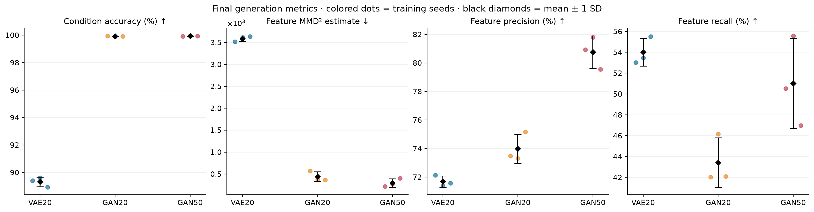

Generation metrics for each training seed, with the mean ± sample standard deviation. Standard deviations are computed across independent training seeds.

## 2. Shared protocol and interpretation of the metrics

The original MNIST training set is divided into a fixed stratified split of 50,000 training images and 10,000 validation images, using split seed 20261010. The official test set is used only for final evaluation. Intermediate evaluations use a fixed sample of 200 validation images per class; final evaluations use a fixed sample of 800 test images per class, with the same number of generated images per class. Reference indices and the full split are saved with the report. Test metrics were not used for model selection during training.

| Setting | VAE | GAN |
| --- | --- | --- |
| Epochs | 20 | 50 |
| Latent dimension / batch size | 20 / 128 | 20 / 128 |
| Adam learning rate | 0.001 | 0.0002 |
| Adam betas | (0.9, 0.999) | (0.5, 0.999) |
| Label representation | 10-dimensional one-hot | 50-dimensional embedding |
| Native training objective | Per-sample mean BCE reconstruction term + KL | D: real + 0.5×(fake+wrong-label); G: real-target BCE |

All images are original 28×28 grayscale images, without data augmentation. Existing PNG files are cached losslessly as uint8 and divided by 255 after loading. GAN training further maps them to [−1,1]; evaluation outputs are consistently mapped back to [0,1]. Both models retain their original architectures, initialization, and loss functions. The last incomplete batch is retained in every epoch.

The shared classifier consists of two 3×3 convolutional layers (32/64 channels, padding=1, each followed by ReLU and 2×2 max pooling), a 128-dimensional ReLU feature layer, and a ten-class output. It is trained only on the same training split, using Adam with learning rate 0.001 and batch size 128 for 10 epochs. The weights with the best validation accuracy are saved and frozen. The best validation accuracy is **99.050%**, and accuracy on the full official test set is **98.960%**. Classifier errors and feature preferences can still affect the evaluation of generated images; classifier judgments are not identical to human assessments of visual quality.

### Metric definitions

**Condition accuracy**: whether the classifier's prediction equals the requested label y. This measures adherence to the condition; it does not independently assess naturalness or diversity within a class. The distribution metrics below group generated images by their **requested labels** and real images by their true labels, then average equally across the ten digits. Generated images classified incorrectly are not filtered out first.

**MNIST feature MMD²**: computed on the frozen classifier's 128-dimensional features, before any PCA projection, using $k(x,y)=(x^\top y/128+1)^3$. The unbiased estimator is

$$\widehat{\mathrm{MMD}}_u^2=\frac{\sum_{i\ne j}k(x_i,x_j)}{m(m-1)}+\frac{\sum_{i\ne j}k(z_i,z_j)}{n(n-1)}-\frac{2\sum_{i,j}k(x_i,z_j)}{mn}.$$

This kernel distance follows the KID evaluation idea in [Bińkowski et al., Demystifying MMD GANs, ICLR 2018](https://arxiv.org/abs/1801.01401). Because this experiment replaces the feature extractor, the metric is called MNIST feature MMD². It should not be treated as standard Inception KID or directly compared with published scores for that metric. An unbiased finite-sample estimate can be negative, so the original value is retained. Its absolute magnitude also depends on the feature scale.

**Distribution precision / recall**: based on the nearest-neighbor ball coverage approach in [Kynkäänniemi et al., Improved Precision and Recall Metric, NeurIPS 2019](https://proceedings.neurips.cc/paper/2019/hash/0234c510bc6d908b28c70ff313743079-Abstract.html). Each feature point defines a ball whose radius is the distance to its 3rd other nearest neighbor. The union of these balls approximates the distribution's support. Precision is the fraction of generated points inside the union of real-data balls; recall is the fraction of real points inside the union of generated-data balls. Both are computed in the 128-dimensional space. High precision and high recall provide indications of quality and coverage, respectively, and can trade off against each other. They are not classification precision/recall and do not fully describe visual quality or the diversity of all handwriting styles. Sample size, outliers, and the feature space all affect these estimates.

## 3. Generation across all classes and conditional control

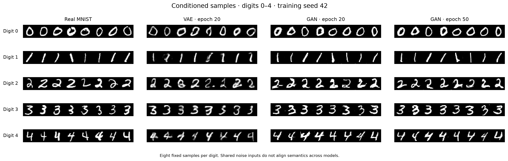

Sample grids covering all digit classes, showing real MNIST images and the three model checkpoints. Sampling seeds are fixed; examples are not selected according to generation quality.

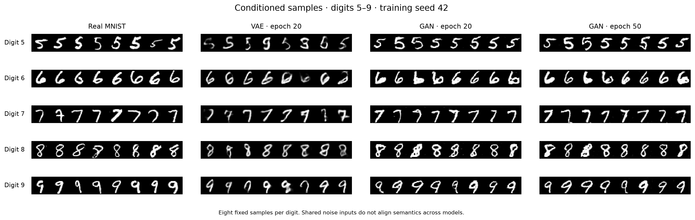

Sample grids covering all digit classes, showing real MNIST images and the three model checkpoints. Sampling seeds are fixed; examples are not selected according to generation quality.

The main figures use training seed 42 and show the first 8 fixed indices per class for real samples and each checkpoint. Images are not filtered by classifier confidence or visual quality. Each row corresponds to a requested label, and columns show different samples from that class. In addition to class correctness, compare stroke continuity, repeated shapes, and grayscale edges against the real images. Grids for the other two training seeds follow the same selection rule and appear in the appendix.

**Visual observations of fixed samples:** In the grid for seed 42, the VAE shows more gray edges and locally weak strokes. The 4th and 7th images requested as digit 5 contain closed loops that look more like 9 and 6. The GAN grids have more consistent class appearance and clearer edges, although some examples of digit 6 still contain thick, merged strokes. These are individual examples to be considered alongside aggregate metrics; impressions from 8 samples cannot replace population statistics.

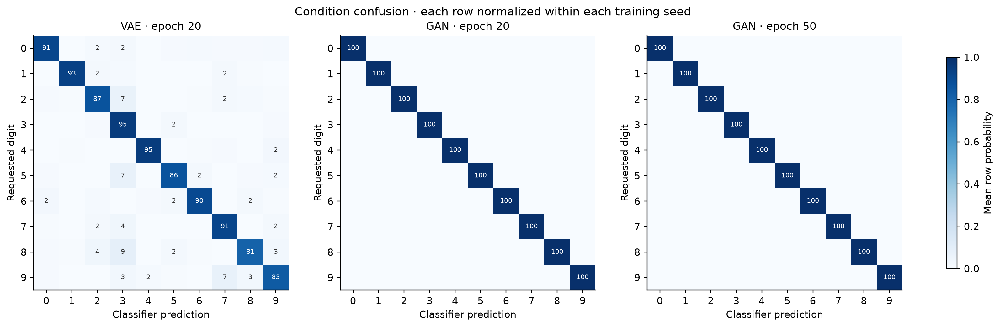

Conditional confusion matrices, normalized by requested-digit row within each training seed and then averaged across seeds. Cell values are percentages.

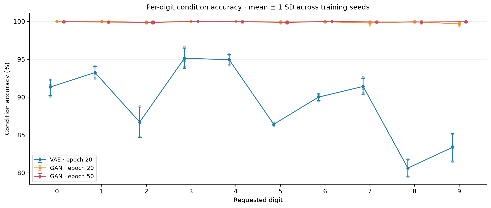

Condition accuracy for each digit and variation across training seeds, so overall averages do not conceal weaker classes.

**VAE20**: the digit with the lowest condition accuracy is 8 (mean across seeds: 80.62%), and the highest is 3 (95.12%). Pooling the seeds, the largest off-diagonal confusion is requested 8, predicted 3: 210 images, or 8.75% of requests for 8. This is a judgment by the frozen classifier. Failure examples should be inspected to distinguish ambiguous shapes from classifier misrecognition.

**GAN20**: the digit with the lowest condition accuracy is 9 (mean across seeds: 99.67%), and the highest is 0 (100.00%). Pooling the seeds, the largest off-diagonal confusion is requested 2, predicted 3: 3 images, or 0.12% of requests for 2. This is a judgment by the frozen classifier. Failure examples should be inspected to distinguish ambiguous shapes from classifier misrecognition.

**GAN50**: the digit with the lowest condition accuracy is 2 (mean across seeds: 99.88%), and the highest is 3 (100.00%). Pooling the seeds, the largest off-diagonal confusion is requested 5, predicted 3: 3 images, or 0.12% of requests for 5. This is a judgment by the frozen classifier. Failure examples should be inspected to distinguish ambiguous shapes from classifier misrecognition.

## 4. Generation quality, within-class coverage, and a shared feature space

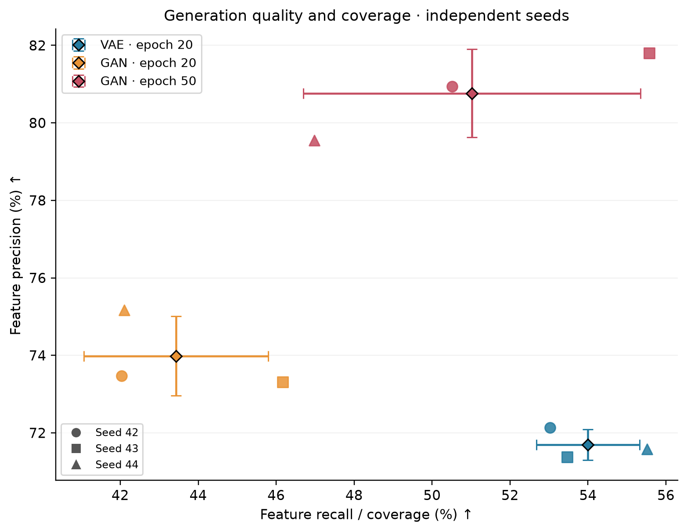

Generation precision and coverage recall in the shared feature space. Points represent training seeds; diamonds and error bars indicate means and standard deviations across seeds.

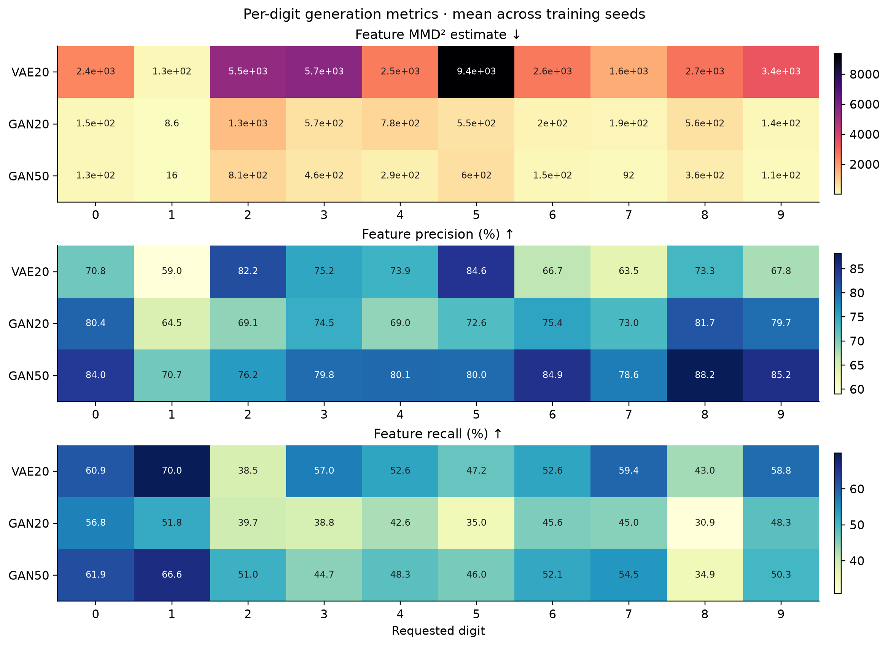

Heatmaps of per-class MMD², feature precision, and recall. Each column corresponds to a requested digit.

VAE20 has distribution precision of 71.70%, recall of 54.00%, and MMD² of 3589.6; digit 2 has the lowest recall. Across the three seeds, the standard deviation of condition accuracy is 0.35 percentage points, and that of recall is 1.33 percentage points. These values describe quality, coverage, and training variation for this implementation. No single metric establishes an overall ranking of the models.

GAN20 has distribution precision of 73.98%, recall of 43.43%, and MMD² of 442.79; digit 8 has the lowest recall. Across the three seeds, the standard deviation of condition accuracy is 0.02 percentage points, and that of recall is 2.36 percentage points. These values describe quality, coverage, and training variation for this implementation. No single metric establishes an overall ranking of the models.

GAN50 has distribution precision of 80.76%, recall of 51.02%, and MMD² of 300.65; digit 8 has the lowest recall. Across the three seeds, the standard deviation of condition accuracy is 0.01 percentage points, and that of recall is 4.32 percentage points. These values describe quality, coverage, and training variation for this implementation. No single metric establishes an overall ranking of the models.

As a scale check, evaluating real training images against the same real test references gives MMD² of 30.05, precision of 85.21%, and recall of 87.93%. This real-vs-real baseline is also affected by finite sampling, so MMD² need not be exactly 0 and precision/recall need not be 100%. It helps interpret magnitudes and is not used for training selection. See [real_baseline.json](data/real_baseline.json) for the complete record.

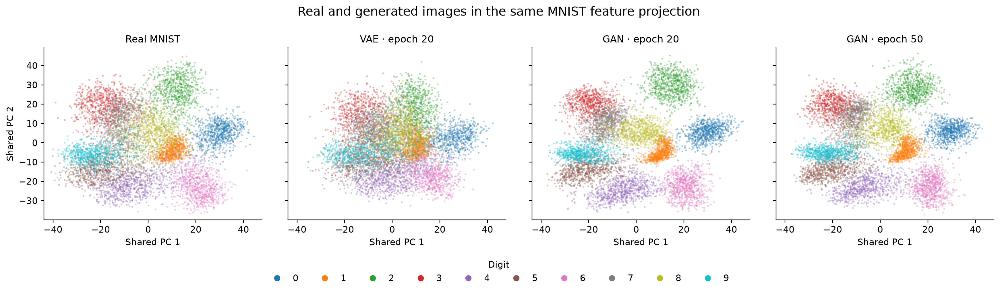

Real and generated distributions in the shared MNIST classifier features, using the same PCA projection. Axes and ranges are identical; overlap in two dimensions is interpreted qualitatively only.

The first and second principal components explain 20.35% and 17.17% of the variance in real training features, respectively, totaling 37.52%. The two-dimensional plot therefore retains limited information. Overlap cannot be interpreted directly as equality of the underlying distributions.

PCA is fitted once, only on real training features. All panels share the same center, projection axes, and coordinate ranges. Digit colors indicate true or requested labels. Nearby positions indicate similarity only along these two projection directions, not necessarily in the full feature space. The statistics above are computed in the original 128-dimensional space; the two-dimensional plot does not replace MMD² or coverage metrics.

## 5. Training efficiency, stability, and generation speed

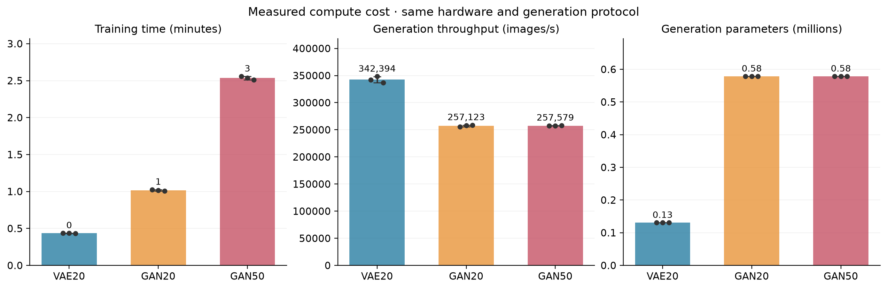

Measured training time, generation throughput, and parameter counts used for generation. Throughput uses the median of repeated timings for the model from each training run.

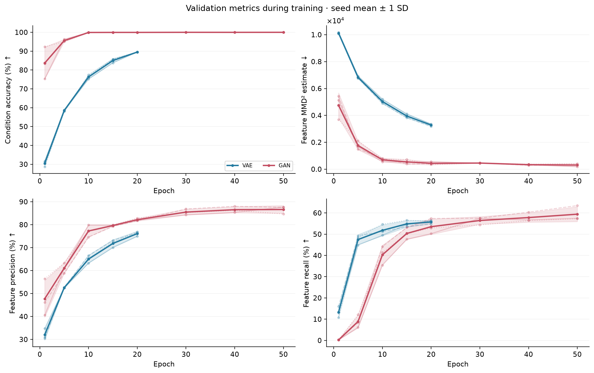

Generation metrics over training epochs. Thin lines represent training seeds; thick lines and shaded regions show the mean and standard deviation at each epoch.

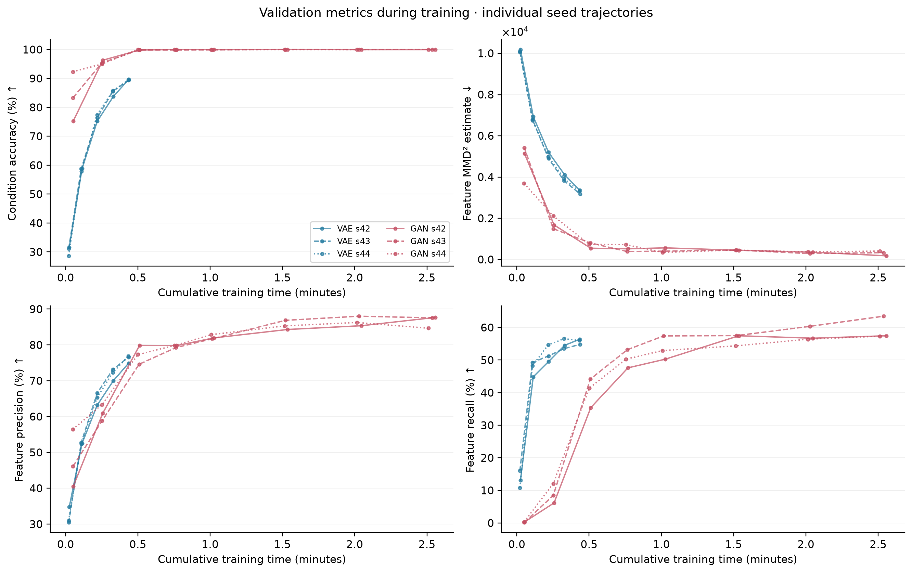

Metrics for each training seed against cumulative training time. Curves are not interpolated and averaged along the time axis.

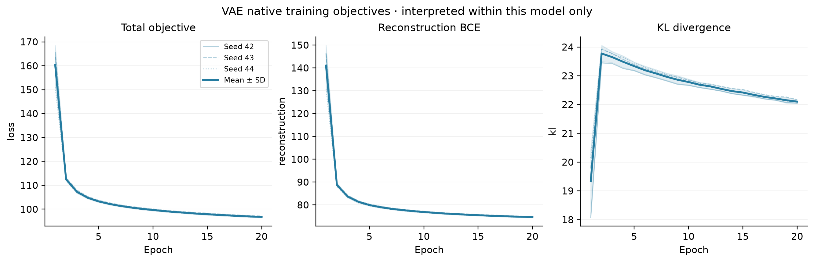

Variation in the VAE's own training objectives across seeds. These loss values are not used to rank performance between VAE and GAN.

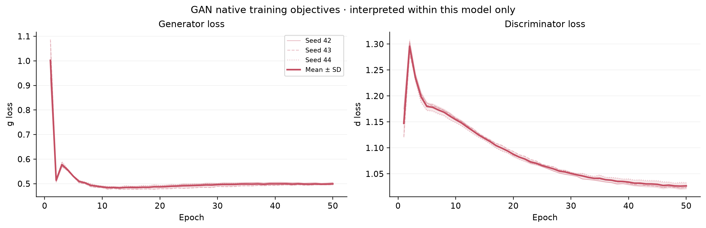

Variation in the GAN's own training objectives across seeds. These loss values are not used to rank performance between VAE and GAN.

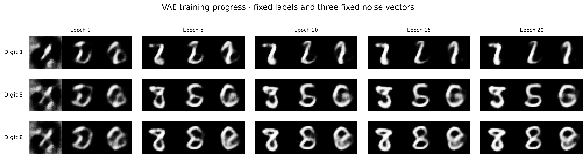

VAE training progress: three fixed latent vectors are tracked for each of digits 1, 5, and 8, rather than showing only one sample.

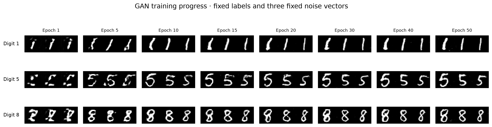

GAN training progress: three fixed latent vectors are tracked for each of digits 1, 5, and 8, rather than showing only one sample.

The curves are evaluated at predefined epochs. Validation references and generated images use fixed, equal sample counts per class. Shading or error bars show standard deviations across training seeds; individual seed values remain visible to reveal fluctuations. Cumulative training time includes loading data from memory, host-to-GPU transfers, forward and backward passes, and optimizer updates, with GPU synchronization for timing. It excludes initial PNG decoding and cache construction, auxiliary classifier training, intermediate evaluation, checkpoint saving, and plotting. Because all runs use a lossless in-memory cache, these loading times do not represent the performance of the older entry points that read individual PNG files from disk.

Training-progress grids use multiple digits and latent vectors to track how the same inputs change during training. The VAE's BCE/KL terms and the GAN's adversarial losses are shown separately. Their meanings and scales differ, so their magnitudes cannot be compared directly across methods. A decrease in a GAN loss also does not automatically imply better generation quality. Intermediate curves use the validation set and fewer samples per class; final test precision/recall should therefore not simply be appended to the ends of those curves.

| Complete training task | Training compute seconds | Intermediate validation seconds | Saving and other seconds | Task wall-clock seconds |
| --- | --- | --- | --- | --- |
| VAE | 26.12 ± 0.11 | 0.11 ± 0.00 | 0.14 ± 0.00 | 26.37 ± 0.11 |
| GAN | 152.10 ± 1.36 | 0.21 ± 0.01 | 0.62 ± 0.02 | 152.93 ± 1.39 |

Auxiliary classifier training and validation took 8.61 seconds of wall-clock time. The sum of wall-clock times for the 6 generative-model training tasks was 537.90 seconds. Each table row summarizes training seeds. Task timing begins after the model and loader have been constructed; it is not the end-to-end duration of the entire experiment. Tasks ran sequentially on the GPU, and GAN20 was not counted as an additional independent task.

Final evaluation, the scale sweep, and diagnostic data preparation took 8.49 seconds in total. This duration is recorded separately and excluded from training time.

| Checkpoint | Total training parameters | Parameters used for generation | Seconds to generate 10,000 images | Throughput / images per second |
| --- | --- | --- | --- | --- |
| VAE20 | 289,785 | 130,529 | 0.02921 ± 0.00050 | 3.4239e+05 ± 5.83e+03 |
| GAN20 | 725,782 | 578,357 | 0.03889 ± 0.00025 | 2.5712e+05 ± 1.64e+03 |
| GAN50 | 725,782 | 578,357 | 0.03882 ± 0.00007 | 2.5758e+05 ± 448 |

The generation benchmark uses batch size 128 and generates 10,000 images per repetition. After warm-up, it repeats 5 times with GPU synchronization for timing. The median duration over the 5 repetitions is computed for each seed, then summarized across seeds. This measures generation compute only for the current hardware and batch size: the forward pass through the decoder/generator with inputs already on the GPU. It excludes random input sampling, transfers, output postprocessing, classifier evaluation, and writing PNG files. VAE training parameters include the encoder and decoder; generation parameters include only decoder_input and decoder. GAN training parameters include G+D, while generation uses only G.

At the same 20 epochs, the ratio of cumulative GAN to VAE training time is **2.33×**. Efficiency should therefore be evaluated using both changes in generation quality and actual elapsed time, rather than epoch counts alone.

## 6. Latent interpolation and label switching

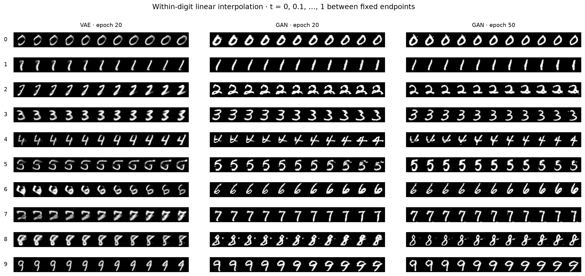

Linear interpolation between random latent endpoints within the same class. Each row fixes the requested digit. The three checkpoints use the same sampling protocol; this does not imply semantic alignment across models.

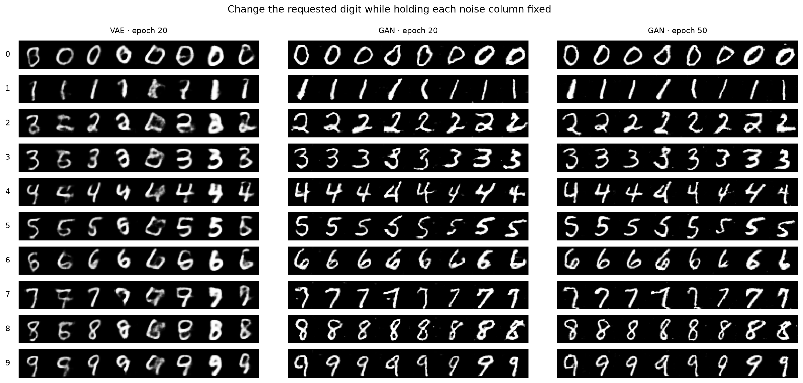

Each column keeps the latent vector fixed while changing the condition label from digit 0 to 9, revealing changes in class control and stroke style.

For each method and requested digit, two predefined random latent vectors are interpolated linearly in 11 steps. Separately, a latent vector is fixed while the condition label is set successively to 0–9. The first experiment examines whether shapes change smoothly as noise changes continuously; the second examines whether the same noise can produce different classes as the label changes. Methods share the input protocol, but the semantics of their latent coordinates are not aligned. The same coordinate need not produce the same stroke changes in both models.

The latent variance at a linear interpolation midpoint is smaller than at the endpoints: independent standard Gaussian endpoints yield a per-dimension midpoint variance of 1/2. Changes in intermediate shapes therefore also reflect changes in the sampling radius and cannot be attributed entirely to semantic control. The noise-scale sweep in the next section provides related evidence. This comparison uses random prior latent vectors for both models; VAE-specific encoding and reconstruction of real images are not mixed into the shared generation comparison.

| Checkpoint / seed | Label-switch accuracy with fixed noise | Condition accuracy at interpolation points | Mean pixel L1 between adjacent interpolation images |
| --- | --- | --- | --- |
| VAE20 / 42 | 85.00% | 93.64% | 0.01319 |
| GAN20 / 42 | 100.00% | 100.00% | 0.01671 |
| GAN50 / 42 | 100.00% | 100.00% | 0.01621 |

The label-switch results use 8 fixed noise vectors × 10 labels, totaling 80 images. The interpolation results use 10 digits × 11 positions, totaling 110 images. Both are computed only for the displayed seed. Adjacent-image pixel L1 measures the magnitude of image changes. A small value can indicate smoothness or insufficient variation; it cannot independently establish semantic controllability or diversity.

**Visual observations of fixed samples:** When labels change within a column of fixed latent vectors, some VAE columns preserve stroke thickness and curvature across labels, while also showing shape deviations for requested labels such as 1, 2, and 3. All 80 GAN images in this set are classified as their requested labels. This shows a difference in conditional adherence between these implementations on these inputs, but does not establish that a single training mechanism alone caused that difference.

## 7. Sampling scale: changes in correctness and coverage

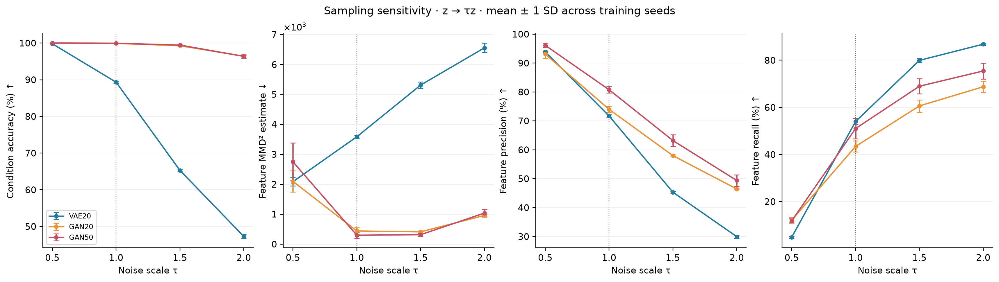

Quality, coverage, and condition accuracy as the Gaussian noise scale changes. τ=1 is the training prior; error bars reflect training seeds.

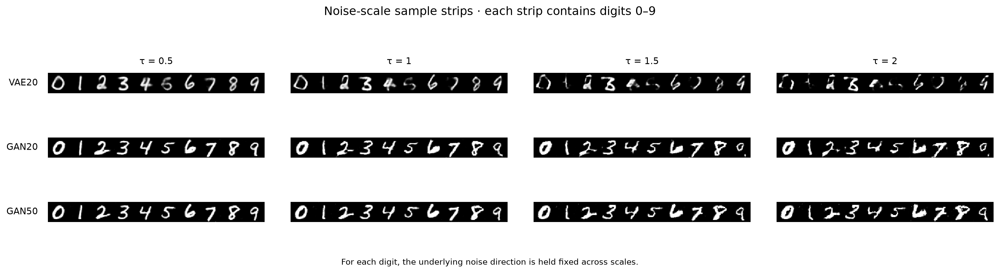

Sample grids that keep the latent direction fixed for each digit and vary only its scale. Each strip contains digits 0–9.

For the same batch of base noise ε, use z=τε with τ∈{0.5,1,1.5,2}. Each scale uses the same requested labels, final references, and sample counts. τ=1 is the standard prior in the main experiment. This sweep is a predefined diagnostic; test results are not used to select a new optimal configuration for the formal comparison.

**VAE20**: at τ=0.5, condition accuracy is 99.81%, precision is 93.85%, and recall is 4.93%; at τ=2, these are 47.28%, 29.93%, and 86.83%, respectively.

For VAE20, increasing τ from 0.5 to 2 changes condition accuracy by -52.53 percentage points, precision by -63.92 percentage points, recall by +81.90 percentage points, and MMD² by +4472. Whether a larger latent magnitude improves coverage must be considered together with incorrect classes and distribution mismatch, rather than judged solely by the extent of image variation.

**GAN20**: at τ=0.5, condition accuracy is 100.00%, precision is 93.08%, and recall is 12.19%; at τ=2, these are 96.40%, 46.44%, and 68.75%, respectively.

For GAN20, increasing τ from 0.5 to 2 changes condition accuracy by -3.60 percentage points, precision by -46.65 percentage points, recall by +56.55 percentage points, and MMD² by -1135.6. Whether a larger latent magnitude improves coverage must be considered together with incorrect classes and distribution mismatch, rather than judged solely by the extent of image variation.

**GAN50**: at τ=0.5, condition accuracy is 100.00%, precision is 96.13%, and recall is 11.90%; at τ=2, these are 96.37%, 49.38%, and 75.46%, respectively.

For GAN50, increasing τ from 0.5 to 2 changes condition accuracy by -3.63 percentage points, precision by -46.75 percentage points, recall by +63.56 percentage points, and MMD² by -1709.6. Whether a larger latent magnitude improves coverage must be considered together with incorrect classes and distribution mismatch, rather than judged solely by the extent of image variation.

At small scales, recall can be very low even when condition accuracy is nearly perfect: generating the requested digit correctly does not imply coverage of its many handwriting styles. At the other extreme, if a large scale reduces accuracy and precision while increasing recall, that increase cannot automatically be described as more valid styles. Outliers and their larger nearest-neighbor balls can expand the estimated support. This is why correctness, quality, and coverage must be examined together. The main comparison always retains τ=1.

| Checkpoint | τ | Condition accuracy | MMD² | precision | recall |
| --- | --- | --- | --- | --- | --- |
| VAE20 | 0.5 | 99.81 ± 0.03% | 2089.6 ± 145 | 93.85 ± 0.13% | 4.93 ± 0.41% |
| VAE20 | 1.0 | 89.32 ± 0.35% | 3589.6 ± 62 | 71.70 ± 0.40% | 54.00 ± 1.33% |
| VAE20 | 1.5 | 65.28 ± 0.36% | 5315.4 ± 110 | 45.31 ± 0.29% | 79.95 ± 0.86% |
| VAE20 | 2.0 | 47.28 ± 0.46% | 6561.6 ± 159 | 29.93 ± 0.50% | 86.83 ± 0.48% |
| GAN20 | 0.5 | 100.00 ± 0.00% | 2097.8 ± 353 | 93.08 ± 1.45% | 12.19 ± 1.25% |
| GAN20 | 1.0 | 99.92 ± 0.02% | 442.79 ± 113 | 73.98 ± 1.02% | 43.43 ± 2.36% |
| GAN20 | 1.5 | 99.27 ± 0.08% | 413.25 ± 37 | 57.96 ± 0.29% | 60.63 ± 2.61% |
| GAN20 | 2.0 | 96.40 ± 0.46% | 962.19 ± 31.6 | 46.44 ± 0.06% | 68.75 ± 2.48% |
| GAN50 | 0.5 | 100.00 ± 0.00% | 2750 ± 631 | 96.13 ± 0.79% | 11.90 ± 0.90% |
| GAN50 | 1.0 | 99.94 ± 0.01% | 300.65 ± 96.8 | 80.76 ± 1.14% | 51.02 ± 4.32% |
| GAN50 | 1.5 | 99.45 ± 0.06% | 318.53 ± 44 | 63.19 ± 2.04% | 68.98 ± 3.17% |
| GAN50 | 2.0 | 96.37 ± 0.43% | 1040.3 ± 125 | 49.38 ± 1.95% | 75.46 ± 3.42% |

**Visual observations of fixed samples:** In the fixed-direction scale grids, VAE strokes become weaker and more fragmented at τ=1.5 and 2, while most GAN examples retain recognizable digit outlines over the same range. This observation is consistent with the marked decrease in VAE condition accuracy and precision at large scales. Greater variation in individual images does not automatically imply greater valid diversity.

## 8. Nearest neighbors and failure cases

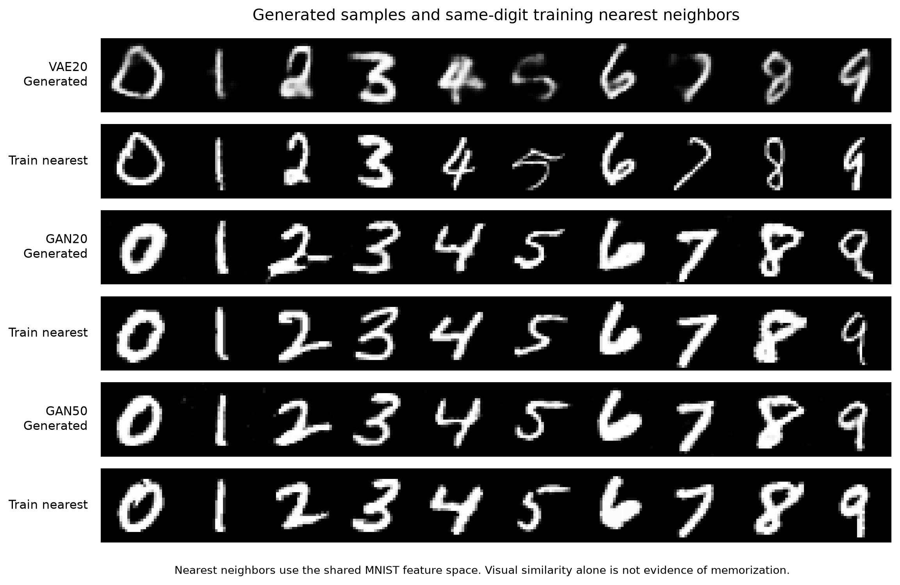

Generated samples and their nearest neighbors in the same-class training features. Similarity supports inspection but cannot independently prove memorization of training images.

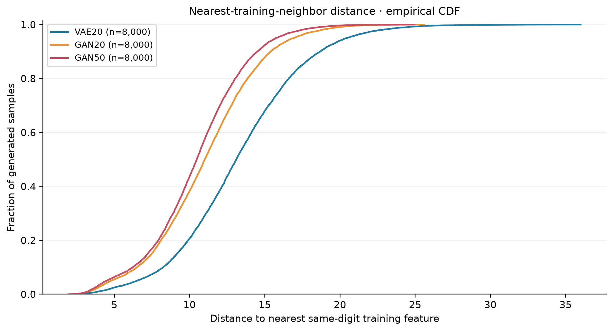

Empirical cumulative distributions of distances from generated images to their nearest neighbors in same-class training features. Distance magnitude is not an independent measure of generation quality or memorization.

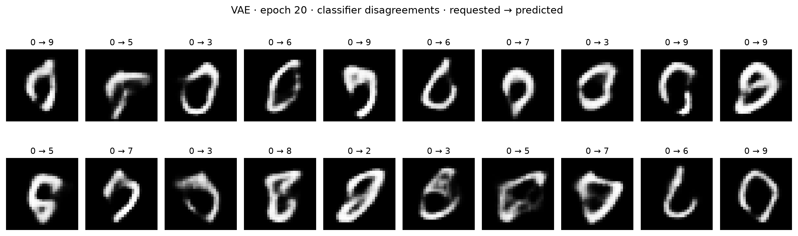

VAE · epoch 20 examples where the classifier disagrees with the requested condition. Images must be inspected; classifier predictions are not human ground truth.

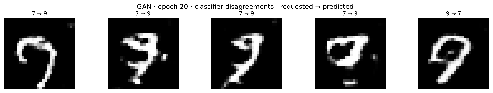

GAN · epoch 20 examples where the classifier disagrees with the requested condition. Images must be inspected; classifier predictions are not human ground truth.

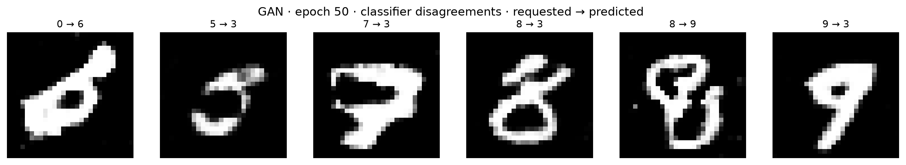

GAN · epoch 50 examples where the classifier disagrees with the requested condition. Images must be inspected; classifier predictions are not human ground truth.

Nearest-neighbor searches are restricted to training images of the same class and use distances in the same frozen classifier's high-dimensional feature space. The figures show a fixed selection of generated images and their matched training images. Similar strokes can reflect the natural similarity of MNIST images within a class or limited coverage; nearest-neighbor similarity alone does not establish memorization. Failure cases are selected in a predefined order from images whose predicted class differs from the requested condition, with both digits shown. These are diagnostic examples; a few cases cannot replace the overall error rate.

For VAE20, among the 8,000 final generated images for display seed 42, 847 are not classified as their requested class (10.59%). The failure gallery represents only examples identified by this fixed detection rule.

For GAN20, among the 8,000 final generated images for display seed 42, 5 are not classified as their requested class (0.06%). The failure gallery represents only examples identified by this fixed detection rule.

For GAN50, among the 8,000 final generated images for display seed 42, 6 are not classified as their requested class (0.07%). The failure gallery represents only examples identified by this fixed detection rule.

| Checkpoint | Mean distance to same-class training nearest neighbor | Median distance | Number of displayed failures |
| --- | --- | --- | --- |
| VAE20 | 13.3019 | 13.1047 | 20 |
| GAN20 | 11.0150 | 11.0108 | 5 |
| GAN50 | 10.4444 | 10.4756 | 6 |

Nearest-neighbor distance statistics use all final generated images for the displayed seed; the main pairing figure shows only the first sample for each requested digit. Failure figures select the earliest 20 condition errors by overall generation index, so they can concentrate on the first few digits. This results from the fixed ordering and does not imply that digits absent from the gallery have no errors. Further raw diagnostic quantities are available in [visual_diagnostics.json](data/visual_diagnostics.json).

**Visual observations of fixed samples:** Among GAN20's 5 classifier-disagreement cases, the last image, "requested 9, predicted 7," still has a clear loop characteristic of 9, and the first image, "requested 7, predicted 9," has a recognizable 7 shape. Classifier disagreement therefore cannot always be treated as a generation error confirmed by a human. Nearest-neighbor pairs have similar outlines, but several differ in stroke thickness and connection details. A small set of pairs can establish neither memorization nor its complete absence.

## 9. Limitations and reproduction

This experiment compares the repository's two specific conditional models with their fixed optimizer settings. Architecture parameter counts are not controlled, and the two methods have not received equal hyperparameter tuning. The VAE uses one-hot conditions, while the GAN uses learnable embeddings. Their methods of injecting conditions and their generation-network capacities also differ, so observed differences cannot all be attributed to the VAE/GAN objectives themselves. The results therefore do not establish universal conclusions about all VAEs and GANs. There are only three training seeds. Fixed sampling noise and reference sets reduce comparison noise, but the error bars do not cover all uncertainty from new reference data, classifier retraining, or new sampling seeds. MMD² and precision/recall rely on the same classifier features and are not fully independent evidence. Findings on MNIST also do not directly represent color natural images.

### Recorded runtime environment

| Item | Recorded value |
| --- | --- |
| GPU | NVIDIA GeForce RTX 5080 |
| PyTorch / torchvision | 2.14.0+cu130 / 0.29.0+cu130 |
| Python | 3.13.15 |
| CUDA / cuDNN | 13.0 / 92400 |
| NumPy | 2.5.3 |
| System | Linux-6.6.87.2-microsoft-standard-WSL2-x86_64-with-glibc2.39 |
| TF32 / CPU threads | False / 4 |
| Git commit at experiment start | c89b2e3cbfa5ccd05abd2e762995edb1d5ffddfe |

Seeds control model initialization, training randomness, and separate DataLoader random streams. Evaluation uses independent samplers and saves/restores the Python, NumPy, and PyTorch CPU/CUDA random states. Generation switches to eval mode and restores the previous state afterward. Every complete epoch saves resumable model, optimizer, and random states; completed tasks are reused only with matching configurations. cuDNN uses deterministic mode, with benchmark and TF32 disabled. This does not guarantee bitwise agreement across hardware or framework versions.

From the repository root, run the following in the existing `vae` environment:

```bash
python tools/compare.py --config configs/comparison.toml --stage all
# Repeat final evaluation and plotting after training
python tools/compare.py --config configs/comparison.toml --stage evaluate
python tools/compare.py --config configs/comparison.toml --stage report
# Small real-data check in a separate directory
python tools/compare.py --config configs/comparison.toml --stage all --smoke
```

To train an independent experiment, copy the configuration and set new directories for `run_dir` and `report_dir`; do not overwrite the existing formal results. The original cache assumes a fixed data source. If that source changes, manage the cache separately. Full training weights and resumable states remain in the experiment run directory and are not copied into the report directory.

### Validation and artifact integrity

Before generating the formal report, the following were verified: training and validation indices are disjoint and cover the original 60,000 training images; every model/seed has a complete epoch history; all required checkpoints have intermediate evaluations; each of the three formal checkpoint groups contains three seeds; all results for the four scales are present; and the actual SHA-256 hashes of the weights and frozen classifier match those used for final evaluation. Summary CSV files and the report text are computed from the same per-seed JSON results. All local image and data links are checked after report generation.

Independent cpu checks passed: distribution_formulas_and_pr_direction, macro_and_confusion, rng_restoration, evaluator_features, generation_isolation, existing_checkpoint_compatibility_cpu. See [comparison-checks-cpu.json](data/comparison-checks-cpu.json) for detailed assertions and execution times.

Independent cuda checks passed: distribution_formulas_and_pr_direction, macro_and_confusion, rng_restoration, evaluator_features, generation_isolation, existing_checkpoint_compatibility_cpu. See [comparison-checks-cuda.json](data/comparison-checks-cuda.json) for detailed assertions and execution times.

### Raw records and integrity

[Summary table](data/summary.csv) · [Per-seed table](data/per_seed.csv) · [Per-class table](data/per_class.csv) · [Scale sweep](data/scale_per_seed.csv) · [Complete final metrics](data/final_metrics.json) · [Configuration](data/config.json) · [Training histories](data/training_histories.json) · [Full split indices](data/split.json) · [Final reference indices](data/test-reference-indices.json) · [Environment](data/environment.json) · [File hashes](data/manifest.json). The starting Git commit and per-file SHA-256 hashes jointly record the uncommitted source state. Each final result also records the actual checkpoint hash.

Source hashes from the start of training are retained in the original environment.json. After training, the only changes to comparison_study.py removed an unused import and allowed the report stage to run without CUDA; training logic was unchanged. The training version was reconstructed by reversing the changes, and its hash was verified. The [training-time source](data/training_comparison_study.py), [patch from training to final version](data/training-to-final.patch), and [source provenance notes](data/code-provenance.json) are saved. The final report manifest separately records current source hashes.

Visual observations of a small set of fixed samples are saved separately in [visual_observations.json](data/visual_observations.json), bound to the SHA-256 hash of the final metrics file. They are human-readable interpretations of images, not additional blind-test scores.

All figures are provided as high-resolution PNG files. Statistical curves, scatterplots, and heatmaps also have SVG versions with matching names in the same figures directory for enlargement and layout.

## Appendix: other training seeds and supplementary figures

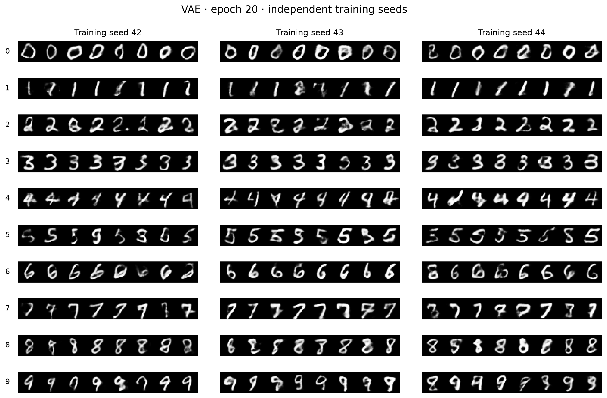

Per-class samples from independent training seeds for VAE · epoch 20, supplementing the main sample grids.

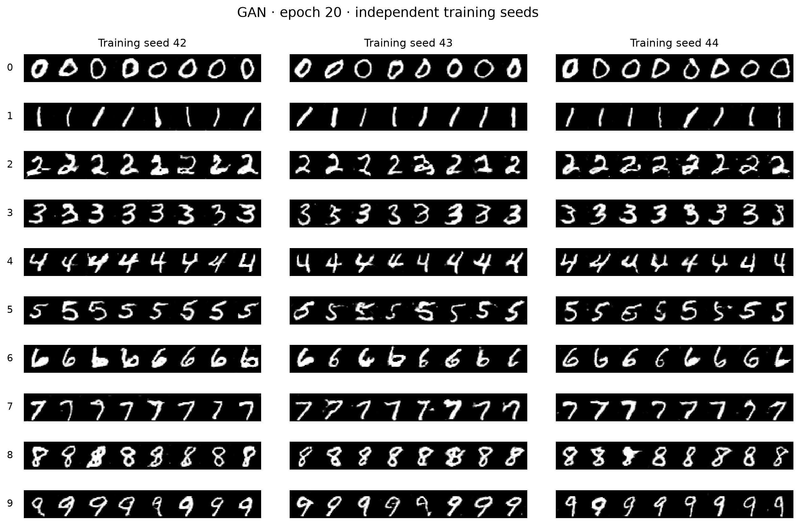

Per-class samples from independent training seeds for GAN · epoch 20, supplementing the main sample grids.

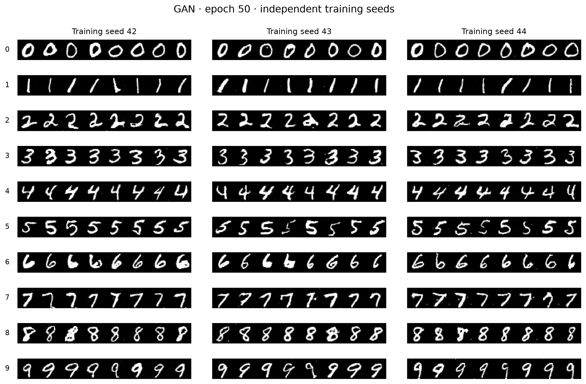

Per-class samples from independent training seeds for GAN · epoch 50, supplementing the main sample grids.
