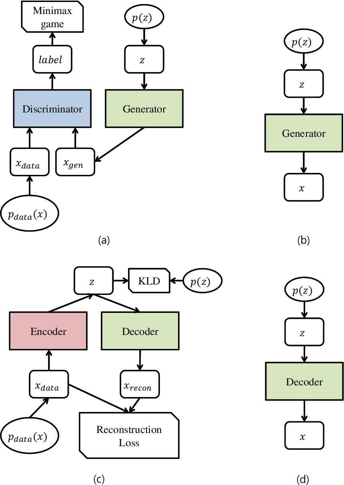
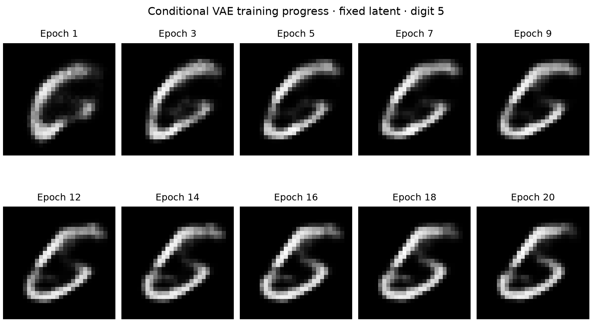
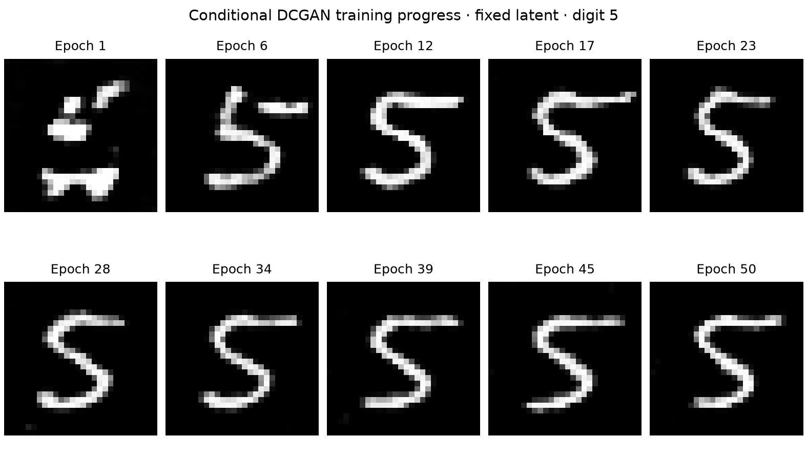
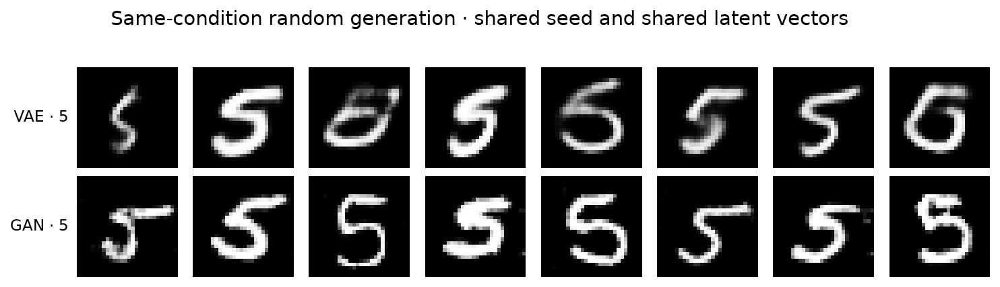

# From Traditional Generative Models to VAEs, GANs, and Diffusion Models

## Research Question and Background

Pattern recognition studies how to extract regularities from observed data and use them for classification, recognition, and prediction. In image classification, for example, a model may learn the relationship between images and classes directly, or it may first learn the distribution of images and then make decisions probabilistically. The latter reflects the central idea of generative modeling: a model learns the statistical process that gives rise to data in order to understand relationships among samples[[1]](#ref-1). Real-world data are high-dimensional, complex, and diverse. Images in the same class may differ substantially in pose, illumination, and background, while images from different classes may share visual features. Describing these variations from a finite sample is a fundamental challenge for generative modeling.

Several model families approach this distribution-learning problem differently. Traditional generative models such as Gaussian mixture models (GMMs) represent data through an interpretable mixture of probability distributions, making parameter estimation and latent-variable inference relatively transparent. Variational autoencoders (VAEs) combine latent-variable models with neural networks. Generative adversarial networks (GANs) train a generator through adversarial learning, whereas diffusion models such as DDPM learn to recover data progressively from noise.

This report first reviews the foundational concepts of joint distributions, maximum-likelihood estimation, and variational inference. It then examines the mathematical basis of GMMs, VAEs, GANs, and diffusion models, and discusses the contributions and limitations of representative work including AEVB, GAN, DDPM, and DDIM. Finally, a controlled MNIST experiment compares a VAE with a DCGAN, providing qualitative evidence for the observation that VAE samples tend to be smooth and may lack fine detail. The possible causes are considered in relation to each model's objective and output formulation.

## Fundamental Concepts and Theory

### Joint and Conditional Distributions in Classification

Let \(x\) denote an observation and \(y\) a class label. Their joint distribution can be factorized as

$$
p(x,y)=p(y)p(x\mid y)=p(x)p(y\mid x).
\tag{1}
$$

Here, \(p(y)\) is the class prior; \(p(x\mid y)\) describes the distribution of observations for a given class; \(p(x,y)\) describes inputs and classes jointly; and \(p(y\mid x)\) is the posterior probability of each class after an input has been observed.

For discrete classes, Bayes' rule gives

$$
p(y\mid x)
=
\frac{p(x\mid y)p(y)}
{\sum_{y'}p(x\mid y')p(y')}.
\tag{2}
$$

A generative classifier can first learn the class prior and class-conditional distributions, then classify with Equation [(2)](#eq:bayes-rule)[[1]](#ref-1).

### Maximum-Likelihood Estimation

Let the training set be \(\mathcal D=\{x^{(1)},\ldots,x^{(N)}\}\), with independent and identically distributed samples, and let \(p_\theta(x)\) be a probabilistic model parameterized by \(\theta\). Treating the data as observed, the likelihood is

$$
L(\theta;\mathcal D)=\prod_{i=1}^{N}p_\theta(x^{(i)}).
\tag{3}
$$

Maximum-likelihood estimation chooses parameters that assign the greatest probability or probability density to the observations. Because the logarithm is monotonic, the product can be converted into a sum, yielding the equivalent objective

$$
\hat\theta_{\mathrm{ML}}
=\arg\max_\theta \log L(\theta;\mathcal D)
=\arg\max_\theta\sum_{i=1}^{N}\log p_\theta(x^{(i)}).
\tag{4}
$$

Here, \(N\) is the number of samples. In practice, minimizing the negative log-likelihood is equivalent to maximizing the log-likelihood[[1]](#ref-1).

### Variational Inference and the Evidence Lower Bound

In a latent-variable model, the marginal likelihood \(p_\theta(x)\), also called the evidence, is often difficult to compute directly; the true posterior \(p_\theta(z\mid x)\) can likewise be intractable. Variational inference approximates the true posterior with a distribution \(q_\phi(z\mid x)\) and defines the evidence lower bound (ELBO) as

$$
\mathcal L_{\mathrm{ELBO}}(x)
=\mathbb E_{z\sim q_\phi(z\mid x)}
\left[\log\frac{p_\theta(x,z)}{q_\phi(z\mid x)}\right].
\tag{5}
$$

Here, \(z\) is the latent variable and \(p_\theta(x,z)\) is the joint distribution. The bound and the log evidence satisfy

$$
\log p_\theta(x)
=\mathcal L_{\mathrm{ELBO}}(x)
+D_{\mathrm{KL}}\!\left(q_\phi(z\mid x)\,\|\,p_\theta(z\mid x)\right).
\tag{6}
$$

The KL divergence measures the discrepancy between two distributions and is non-negative, so the ELBO cannot exceed the log evidence; equality holds when the two posteriors coincide. Maximizing the ELBO makes it possible to learn the model and approximate posterior jointly, providing a tractable objective for models such as VAEs[[2]](#ref-2).

### What It Means to Model Conditional and Joint Distributions

In the discussion below, \(x\) denotes an observation and \(y\) denotes a class label.

**Modeling \(p(y\mid x)\) means representing uncertainty over classes after an input is given.** For a fixed input \(x\), the model distributes probability across the possible classes, and these probabilities sum to one. Cross-entropy training, for example, learns this distribution by increasing the conditional probability of the true label in the training data; classification then selects the class with the largest posterior probability. The model primarily answers how a known input should be classified and is therefore discriminative.

**Modeling \(p(x\mid y)\) means representing variation in the data for a given class.** For a fixed class \(y\), the model describes possible input values and their relative likelihoods, so each class defines a distribution over \(x\). Conditional maximum-likelihood training raises the probability or density of every observation under its class. Sampling from the model then generates new data for a specified class.

**Modeling \(p(x,y)\) means representing the joint distribution of inputs and classes.** According to Equation [(1)](#eq:joint-distribution), the joint distribution can be factorized as \(p(y)p(x\mid y)\): first sample a class from the prior \(p(y)\), then sample an observation from the corresponding class-conditional distribution \(p(x\mid y)\), producing an \((x,y)\) pair. The same joint distribution can also be written as \(p(x)p(y\mid x)\). Summing over \(y\) yields the input marginal \(p(x)=\sum_y p(x,y)\); conditioning the joint distribution yields the posterior \(p(y\mid x)\) used for classification. A joint model therefore contains information about \(x\), \(y\), and their statistical relationship.

These distributions are connected by the product rule and Bayes' rule, but converting one conditional distribution into another also requires the appropriate marginal distribution. The same \(p(y\mid x)\), for instance, can be paired with different \(p(x)\) distributions to form different joint distributions. Learning the classifier \(p(y\mid x)\) alone therefore does not mean that the input distribution has also been learned. Conversely, \(p(x\mid y)\) together with \(p(y)\) determines \(p(x,y)\), from which \(p(y\mid x)\) can be derived. Discriminative modeling focuses on class prediction; generative modeling must additionally represent the data distribution, often requiring density estimation, marginalization, or sampling.

## Representative Methods and Their Mathematical Principles

The objective of a generative model is to learn the distribution of the training data and produce new samples with similar characteristics. The main differences among methods lie in how they represent the data distribution and how they turn randomness into structured data.

### Gaussian Mixture Models

A Gaussian mixture model (GMM) represents data with a weighted combination of Gaussian distributions. Intuitively, one Gaussian can describe observations concentrated around a single center; when the data contain several groups, several distributions can be combined:

$$
p(x)=\sum_{k=1}^{K}\pi_k\mathcal N(x;\mu_k,\Sigma_k).
\tag{7}
$$

Here, \(x\) is an observation, \(K\) is the number of components, and \(\mu_k\) and \(\Sigma_k\) control the center and spread of component \(k\). The weights \(\pi_k\) are non-negative and sum to one. To generate a sample, the model first selects a component according to the mixture weights and then samples from that Gaussian; the selected component index is a discrete latent variable[[1]](#ref-1).

GMM parameters are commonly estimated by expectation-maximization (EM). The E-step computes the probability that each sample belongs to each component. The M-step uses these probabilities as weights to update the means, covariances, and mixture coefficients. Alternating the two steps progressively improves the fit to the data[[3]](#ref-3).

GMMs have a clear structure and are useful for clustering and density estimation. For complex high-dimensional data such as images, however, they often require many components, increasing both the number of parameters and the difficulty of estimation.

### Variational Autoencoders

A variational autoencoder (VAE) assumes that data are generated from a continuous latent variable \(z\) and uses neural networks to describe this process. The latent variable can be understood as a compressed representation that retains the information needed to generate a sample. A standard Gaussian is typically used as the prior \(p(z)\), while the decoder defines the conditional distribution \(p_\theta(x\mid z)\) from which data are generated.

Training also requires an encoder that estimates a latent distribution from an input. Because the true posterior is usually intractable, the encoder approximates it with \(q_\phi(z\mid x)\), commonly outputting the mean and variance of a Gaussian. A latent code is sampled from this distribution and passed to the decoder to reconstruct the input. The parameters \(\phi\) and \(\theta\) belong to the encoder and decoder, respectively. Because the encoder returns a distribution rather than a fixed code, the same input can correspond to different latent samples.

A VAE is trained by maximizing the ELBO:

$$
\mathcal L_{\mathrm{ELBO}}(x)
=
\mathbb E_{z\sim q_\phi(z\mid x)}[\log p_\theta(x\mid z)]
-
D_{\mathrm{KL}}\!\left(q_\phi(z\mid x)\,\|\,p(z)\right)
\leq \log p_\theta(x).
\tag{8}
$$

The expectation averages over latent samples. The first term encourages the decoder to reconstruct the input accurately; the second measures, through KL divergence, how far the approximate posterior departs from the prior. Together they constrain the latent space so that it both preserves information about a sample and remains amenable to sampling from the prior.

To make sampling compatible with backpropagation, VAEs use the reparameterization trick: independent standard Gaussian noise is sampled first, then scaled by the encoder's predicted standard deviation and shifted by its predicted mean. This formulation allows gradients to propagate back through the encoder.

New samples can be produced simply by sampling from the prior and passing the result to the decoder. Classical image VAEs often produce smooth outputs and may lose fine detail.

### Generative Adversarial Networks

A generative adversarial network (GAN) learns to generate data through competition between two networks. The generator \(G\) receives random noise \(z\) drawn from a simple prior \(p(z)\) and outputs a sample \(G(z)\). The discriminator \(D\) receives either a real or generated sample and estimates the probability that it came from the real data. The generator tries to make its samples more realistic, while the discriminator tries to distinguish real from fake.

The original GAN objective is

$$
\min_G\max_D
\left\{
\mathbb E_{x\sim p_{\mathrm{data}}}[\log D(x)]
+
\mathbb E_{z\sim p(z)}[\log(1-D(G(z)))]
\right\}.
\tag{9}
$$

Here, \(p_{\mathrm{data}}\) is the real-data distribution. The two expectations average over real samples and random noise, respectively. The discriminator maximizes the objective by assigning high scores to real samples and low scores to generated ones. The generator minimizes it by trying to make generated samples receive higher scores. The two networks are updated alternately, so the discriminator provides a continually evolving learning signal for the generator.

In the ideal case, the generated and real distributions coincide, and the optimal discriminator assigns both classes a probability of one half. Training does not necessarily reach this equilibrium. A GAN need not explicitly evaluate the probability density of generated data and is therefore an implicit generative model; after training, only the generator is required for sampling.

GANs often produce sharp images, but the two networks influence one another and training can oscillate. Mode collapse may also occur, causing the generator to repeat a small set of similar samples while missing other modes of the real distribution. Visually convincing images therefore do not by themselves show that the model has learned the diversity of the data.

### Diffusion Models

Diffusion models decompose generation into a sequence of denoising steps. During training, Gaussian noise is progressively added to real data until the original structure is obscured, and a neural network learns how to denoise inputs at different noise levels. Generation begins with random noise and gradually produces a structured sample[[4]](#ref-4).

Let \(x_0\) be an original sample and \(\beta_t\) the noise intensity at step \(t\). Define \(\alpha_t=1-\beta_t\) and \(\bar\alpha_t=\prod_{s=1}^{t}\alpha_s\). A noisy sample at any time step can be computed directly as

$$
x_t=\sqrt{\bar\alpha_t}\,x_0+\sqrt{1-\bar\alpha_t}\,\epsilon,
\qquad \epsilon\sim\mathcal N(0,I).
\tag{10}
$$

Here, \(\epsilon\) is standard Gaussian noise, \(I\) is the identity matrix, and \(\bar\alpha_t\) is the proportion of the original signal that remains. As \(t\) increases, the signal contribution decreases and the noise contribution increases. When the final signal contribution is sufficiently small, the sample distribution approaches a standard Gaussian. The noising rule is fixed in advance and does not need to be learned; a training input \(x_t\) can also be obtained directly without executing every preceding noising step.

The network learns the reverse task: denoising. A common formulation gives the network \(x_t\) and \(t\), asks it to predict the added noise \(\epsilon_\theta(x_t,t)\), and minimizes the simplified objective

$$
\mathcal L_{\mathrm{simple}}(\theta)
=
\mathbb E_{x_0,t,\epsilon}
\left[\left\|\epsilon-\epsilon_\theta(x_t,t)\right\|_2^2\right].
\tag{11}
$$

Here, \(\theta\) denotes the network parameters, and the squared norm measures the error between the predicted and actual noise. During training, a data sample and a time step are selected, Gaussian noise is generated, and a noisy input is constructed. One network can therefore learn recovery rules across many noise levels, with the time step indicating the current degree of corruption.

At generation time, the process starts from standard Gaussian noise and repeatedly updates the sample according to the network prediction and a prescribed sampling rule, lowering the noise level until a final output is obtained. The model synthesizes a new sample from patterns learned in the training data; it does not recover a particular training example.

The noise-prediction objective is comparatively direct, and diffusion models can often balance sample quality with diversity. Conventional sampling, however, calls the network repeatedly and is slow. Training and inference are computationally expensive, so the number of sampling steps, output quality, and efficiency must be balanced.

## Analysis of Representative Literature

VAEs, GANs, and diffusion models embody distinct approaches to deep generative modeling. Kingma and Welling's *Auto-Encoding Variational Bayes* combines variational inference with deep neural networks, enabling continuous latent-variable models to be trained end to end with stochastic gradients[[5]](#ref-5). Goodfellow et al.'s GAN avoids explicit density modeling and learns through competition between a generator and a discriminator[[6]](#ref-6). DDPM later recasts generation as an iterative process that restores data from noise[[7]](#ref-7), while DDIM redesigns the sampling process to address the slow generation of diffusion models[[8]](#ref-8). Together, these four papers represent influential approaches based on latent-variable modeling, adversarial learning, and iterative generation.

### Auto-Encoding Variational Bayes

In *Auto-Encoding Variational Bayes*, Kingma and Welling present a scalable learning and inference method for generative models with continuous latent variables, establishing the framework now widely known as the variational autoencoder (VAE)[[5]](#ref-5). The paper is not merely concerned with a new neural-network architecture; its central question is how probabilistic generative models containing continuous latent variables can be trained efficiently on large datasets.

Traditional latent-variable models assume that observations arise from hidden factors and use those variables to explain how the data are produced. A face image, for example, contains many pixels, but those pixels may be governed by more compact factors such as identity, pose, expression, and illumination. A generative model seeks to describe both the distribution of those factors and the way they produce observed data. For complex observations and generative processes, however, inferring latent variables from data is often difficult and the true posterior is usually intractable. Classical variational inference may require a separate optimization for every sample, making it difficult to scale directly to large datasets and deep neural networks.

A central design in *Auto-Encoding Variational Bayes* is a neural network dedicated to inference. For any input sample, the network directly predicts the parameters of its latent distribution instead of running a separate optimization. This network is now called the encoder, while the generative network that maps latent variables to data is called the decoder. A VAE can therefore be viewed as the combination of an inference model and a generative model.

The encoder differs fundamentally from the encoder in a conventional autoencoder. A standard autoencoder usually compresses an input into a deterministic low-dimensional vector and asks a decoder to recover the input. A VAE encoder instead estimates a probability distribution over latent variables. The same input corresponds not to one fixed point in latent space but to a probabilistic region. In a common implementation, the encoder outputs the parameters of this distribution, a particular latent variable is sampled, and the decoder uses that sample for generation or reconstruction.

This design gives the VAE latent space a direct probabilistic interpretation. Rather than memorizing which vector belongs to each example, the model tries to arrange the latent variables for different samples into a continuous global distribution. After training, a new latent value can be drawn from the prescribed prior and passed to the decoder without supplying an input. A VAE thus has two operating modes: during training and reconstruction, data pass through the encoder and decoder; during unconditional generation, the encoder is unnecessary, and samples are drawn directly from the latent space and decoded.

Figure [1](#fig:gan-vae-architecture) contrasts the training and generation structures of GANs and VAEs. Panel (c) shows a VAE trained jointly through its encoder and decoder, while panel (d) shows that generation after training uses only the decoder. The comparison helps distinguish the encoder's inference role from the decoder's generative role.

<figure id="fig:gan-vae-architecture">
  
  <figcaption>Figure 1. Training and generation structures of GANs and VAEs: (a) GAN training; (b) GAN generation; (c) VAE training; and (d) VAE generation.[[9]](#ref-9)</figcaption>
</figure>

The reparameterization method introduced in AEVB is what makes this training process practical. Latent variables must be sampled, but an ordinary sampling operation blocks gradient propagation and prevents the encoder from being trained by standard backpropagation. AEVB moves the randomness into an independent noise variable, expressing the latent sample as a differentiable transformation of the encoder output and random noise. Sampling remains stochastic, but the influence of the network parameters on the result becomes differentiable, so the encoder and decoder can be optimized jointly by stochastic gradient descent. The paper uses this idea to construct estimators of the variational lower bound that are compatible with standard stochastic-gradient optimization and thereby enables efficient inference in continuous latent-variable models.

The VAE training pipeline can be divided into four stages. First, a real sample is passed to the encoder, which estimates a corresponding latent distribution. Second, a latent variable is sampled from that distribution. Third, the latent sample is passed to the decoder to produce an output corresponding to the original data. Finally, the networks are updated according to both the difference between the output and the input and the discrepancy between the latent distribution and the prescribed prior. The first objective requires the model to preserve enough information for reconstruction; the second prevents the latent representations of different samples from scattering arbitrarily and encourages a regular, continuous latent space.

VAE training is therefore not simply an attempt to compress and restore data as accurately as possible. With a reconstruction objective alone, an encoder could map every training example to an isolated point. Such a model might reconstruct the training set well yet fail to generate a plausible result from a randomly selected location in latent space. Constraining the latent distribution encourages nearby locations to behave continuously, making random sampling and latent interpolation meaningful. This is what turns the VAE from a representation-learning system into a genuine generative model.

From a generative perspective, the regularities learned by a VAE reside primarily in the decoder and its associated generative model. The encoder answers the inference question, “given the data, what latent variable may have produced them?” The decoder learns the generative relationship, “given a latent variable, what data should be produced?” During training, the encoder finds latent representations associated with real data and supplies useful signals to the decoder. Once training is complete, the encoder is unnecessary if the task is only to generate new samples: a latent variable can be drawn from the prior and decoded directly. The decoder thus maps latent space to data space, while the encoder primarily provides efficient approximate inference.

The VAE's major advance over classical latent-variable models is its integration of probabilistic generative modeling with deep neural networks. Neural networks provide an expressive mapping from latent variables to complex high-dimensional observations, while the encoder avoids repeatedly solving a difficult optimization problem for each sample and makes minibatch stochastic-gradient training possible. The original paper emphasizes this shared inference network—now commonly called amortized inference—which has become a basic design principle in many later deep latent-variable models.

VAEs also have clear limitations. The model must balance accurate reconstruction against regularity of the overall latent distribution. If continuity is emphasized too strongly, sample details may be lost; early image VAEs in particular often produce smoother outputs with less fine texture than later GANs and diffusion models. A simple prespecified prior may also be unable to describe the complex latent structure of real data. These issues motivated more flexible latent-variable models and alternative generative paradigms.

Overall, the principal contribution of *Auto-Encoding Variational Bayes* is not merely an “encoder plus decoder” architecture, but a method for efficiently training continuous latent-variable generative models with neural networks. The encoder solves approximate posterior inference, the decoder implements data generation, and reparameterization brings stochastic latent variables into ordinary backpropagation. The resulting VAE connects probabilistic modeling, latent representations, and deep learning, marking an important transition from traditional to modern generative models.

### Generative Adversarial Networks

Goodfellow et al. introduced the generative adversarial network (GAN) in 2014[[6]](#ref-6), proposing a training strategy different from that of VAEs. Instead of explicitly designing an encoder to approximate a latent posterior, a GAN trains two networks—a generator and a discriminator—through an adversarial process.

The generator takes random noise as input and maps it to a sample in the same space as the real data. The discriminator receives both real and generated samples and predicts whether each input came from the data or the generator. During training, the discriminator becomes better at separating real from generated data, while the generator improves the realism of its outputs so that they are harder to classify correctly. The original paper formulates this interaction as a two-player minimax game between a generative model and a discriminative model.

The main difference between GANs and VAEs lies in how they learn. A VAE specifies a latent-variable probabilistic process and uses an encoder for approximate inference. A GAN instead relies on the learning signal supplied by the discriminator to push the generator indirectly toward the real-data distribution. Only the generator is needed at inference time, and it can produce a complete sample directly from random noise without iterative inference.

Adversarial learning can produce sharp images and has driven major advances in high-quality image generation, but training is sensitive. The generator and discriminator must remain reasonably balanced; if one learns much faster than the other, optimization can become unstable. The generator may also cover only part of the real distribution, a failure known as mode collapse. Much subsequent GAN research has focused on architecture, training stability, and mode coverage.

### Denoising Diffusion Probabilistic Models

The Denoising Diffusion Probabilistic Models (DDPM) proposed by Ho, Jain, and Abbeel in 2020 established diffusion probabilistic models as an important direction in deep generative modeling[[7]](#ref-7). Unlike a VAE that generates data from a low-dimensional latent variable in one pass, or a GAN that maps random noise directly to data, DDPM expresses generation as a gradual removal of noise.

DDPM contains two processes that run in opposite directions. The forward process repeatedly adds a small amount of random noise to real data. After enough steps, the original data have been almost completely destroyed and approach pure random noise. This process deliberately constructs a path from the complex real-data distribution to a simple noise distribution.

The model learns the reverse process: how to turn noisy data into progressively cleaner data. During training, real samples are corrupted to different noise levels, and a neural network learns to estimate the noise they contain. After training, the model can start from a completely random noise sample and apply denoising repeatedly. Global structure, local shape, and detail emerge gradually until the final output resembles a new sample from the training distribution. Ho et al. showed that this iterative denoising approach can generate high-quality images.

Unlike GANs, DDPM does not train a generator and discriminator adversarially, so optimization is generally more stable and can provide good sample quality and distribution coverage. Its principal drawback is that generation requires many consecutive denoising steps. The network must be evaluated repeatedly for every sample, making sampling much slower than one-pass methods such as GANs.

### Denoising Diffusion Implicit Models

To address the large number of DDPM sampling steps and the resulting slow generation, Song, Meng, and Ermon proposed Denoising Diffusion Implicit Models (DDIM) in 2020[[8]](#ref-8). DDIM does not train an entirely different diffusion model. Instead, it reexamines the relationship between diffusion training and sampling and derives a more flexible reverse-generation procedure.

Standard DDPM sampling denoises along a long, predefined sequence of time steps. DDIM constructs a non-Markovian forward process with the same conditional marginals as DDPM and derives the corresponding reverse process. The same training objective can then support a much shorter path from noise to data. A pretrained diffusion model can therefore use alternative sampling schedules rather than following every step of the original DDPM reverse chain. The experiments in the paper show that DDIM can substantially reduce sampling time under suitable settings while maintaining good generation quality.

DDIM can also make generation deterministic: the same initial noise and sampling procedure produce the same output. This property is useful not only for accelerated sampling, but also for latent interpolation and later image-editing applications.

In summary, DDPM established the basic “progressive noising—learned progressive denoising” framework, while DDIM showed that the return path from noise to data can be redesigned under the same model and training objective to use fewer generation steps. Reducing diffusion sampling cost without sacrificing output quality has since remained an important research direction.

## Comparison of Methods

GMMs, VAEs, GANs, and DDPM all generate new samples by learning a data distribution. They differ primarily in their representation of that distribution, their training objectives, and their trade-offs between generation quality and computational cost. Table 1 compares their classical forms.

**Table 1. Comparison of four classical generative models**

| **Model** | **Representation** | **Training** | **Main strengths** | **Main limitations** |
| --- | --- | --- | --- | --- |
| GMM | Weighted mixture of Gaussian distributions | Maximum-likelihood estimation with EM | Tractable density; interpretable and useful for clustering | Complex high-dimensional data often require many components |
| VAE | Continuous latent variables with a neural decoder | Maximization of the ELBO | Supports representation learning, reconstruction, and generation | Approximate inference introduces error; image detail can be smooth |
| GAN | Mapping from random noise to data | Alternating adversarial training of generator and discriminator | Often produces sharp images; direct sampling | Training may be unstable and susceptible to mode collapse |
| DDPM | Multi-step reverse denoising | Prediction of noise at different time steps | Strong sample quality and diversity | Repeated network evaluations make sampling expensive |

From the perspective of probabilistic representation and inference, a GMM directly defines a mixture density, with a discrete latent variable indicating the component that generated a sample. A VAE uses continuous latent variables to describe data variation and a neural network to define generation. Although a VAE has an explicit probabilistic model, its marginal density is usually intractable, so an encoder approximates the posterior and a likelihood lower bound is optimized. A GAN's generator and noise prior also define a generative distribution, but its density is generally unavailable. DDPM connects noise and data through a sequence of reverse conditional distributions, decomposing generation into many steps.

Training behavior and output quality also differ. GMM parameter estimation is conceptually direct, although the result depends on the number of components and initialization. A VAE balances reconstruction against regularization of the latent distribution. A GAN uses the discriminator's signal to obtain sharp images, but imbalance between the two networks can destabilize training, and generated samples may concentrate on a few modes. DDPM uses a comparatively direct noise-prediction objective without the balance problem of adversarial training, although its performance still depends on the network, noise schedule, and training resources.

In terms of sampling efficiency and application, GMMs suit lower-dimensional data with cluster structure and also serve as basic density estimators. VAEs are useful when latent representations, reconstruction, and generation are all required; generation needs only one draw from the prior and one decoder pass. GANs likewise sample directly from a generator and are attractive when visual sharpness and generation speed matter, but their stability and mode coverage require care. DDPM typically spends more computation to obtain strong generation quality and is appropriate when iterative sampling cost is acceptable.

## Experimental Validation

### Objective and Setup

To examine the claim that VAE outputs are often smooth and may lack detail, we conducted a small experiment on the MNIST handwritten-digit dataset and compared the samples of a VAE and a DCGAN. The implementation is available in the [VAEvsGAN repository](https://github.com/Sy-SU/VAEvsGAN), and the main settings are listed in Table [2](#tab:experiment-settings).

**Table 2. Main training settings for the VAE and DCGAN experiments**

| **Parameter** | **VAE** | **DCGAN** |
| --- | --- | --- |
| Epochs | 20 | 50 |
| Batch size | 128 | 128 |
| Latent dimension | 20 | 20 |
| Optimizer | Adam | Adam |
| Learning rate | 0.001 | 0.0002 |
| Adam momentum parameters | (0.9, 0.999) | (0.5, 0.999) |

The VAE uses a convolutional encoder and a transposed-convolution decoder. Its loss is the sum of a pixelwise binary cross-entropy reconstruction term and a KL term with weight 1. The DCGAN uses alternating adversarial training with the non-saturating generator loss. The discriminator also treats real images paired with incorrect class labels as negative examples, strengthening the conditional constraint. VAE input pixels are normalized to the range 0 to 1; DCGAN training uses the range -1 to 1. Both are visualized in a common grayscale range of 0 to 1.

### Training Progress

To observe how the models evolve during training, we fixed both the latent variable and the class condition to the digit “5” and recorded outputs from each model at ten checkpoints. In Figure [2](#fig:experiment-vae-progress), the VAE already forms a continuous outline after the first epoch. The stroke then becomes more concentrated, but a broad grayscale transition remains along its edges. Later outputs visually resemble a “6” more than a “5,” showing that smooth edges and an imperfectly satisfied class condition are separate issues.

<figure id="fig:experiment-vae-progress">
  
  <figcaption>Figure 2. VAE training progress</figcaption>
</figure>

In Figure [3](#fig:experiment-gan-progress), the first-epoch DCGAN result contains disconnected strokes, but a recognizable “5” gradually emerges. Later outputs have strong contrast between strokes and background and relatively clear outlines, although local shapes still vary and a few stray bright pixels remain.

<figure id="fig:experiment-gan-progress">
  
  <figcaption>Figure 3. DCGAN training progress</figcaption>
</figure>

### Samples Under the Same Condition

Figure [4](#fig:experiment-samples) compares random samples after training. Each model contributes eight images; each column uses numerically identical latent values, and all samples are conditioned on the digit “5.”

<figure id="fig:experiment-samples">
  
  <figcaption>Figure 4. Random samples conditioned on the digit “5”</figcaption>
</figure>

The VAE produces coherent strokes, but some edges are soft, local intensities are faint, and several openings and turns are poorly defined. The shapes in columns 3 and 8 are also difficult to recognize as “5.” Most DCGAN samples have sharper outlines, with more distinct upper horizontal strokes and lower curves.

The code suggests that the smooth VAE outputs may be related both to the output formulation and to KL regularization. The decoder returns Sigmoid probabilities directly without Bernoulli sampling, so uncertain edge pixels appear gray and soften the outline. The KL constraint may additionally remove some detail from the latent representation, contributing to grayscale transitions and a loss of fine structure.

## Limitations of Existing Methods

VAE outputs may have smooth outlines and limited detail. Common implementations use a pixelwise reconstruction objective, but pixel-level fit does not align perfectly with visual quality. Under a Bernoulli likelihood, for example, displaying the decoder's pixel probabilities directly as grayscale values turns intermediate probabilities around edges into smooth intensity transitions. Analysis should therefore distinguish the model's representational capacity from visual effects caused by the output procedure rather than attributing every smooth result to a failure to learn detail[[10]](#ref-10).

A VAE must also balance information preservation against regularization of the latent distribution. The reconstruction term encourages the latent variable to retain enough information to recover the input, while the KL term pushes the approximate posterior toward the prescribed prior. Strong KL regularization may reduce the amount of detailed information kept in the latent representation. Weakening it can improve reconstruction, but does not necessarily improve samples drawn from the prior. Reconstruction ability and generative ability should therefore be evaluated separately; reconstruction error alone is not a sufficient measure of model performance[[5]](#ref-5).

Moreover, the unsupervised VAE objective does not directly require the latent representation to separate classes well. A model that reconstructs inputs accurately does not necessarily preserve the information most useful for classification. In pattern-recognition applications, visual inspection of generated samples or comparison of reconstruction errors remains insufficient for assessing the value of the latent representation. Its performance on real classification tasks must also be evaluated[[11]](#ref-11).

## Recent Research

Recent work on generative models continues to focus on learning complex data distributions more effectively, but the emphasis has shifted from simply comparing foundational paradigms such as VAEs, GANs, and diffusion models toward architectural scalability, the design of generative paths, and training and sampling efficiency. Transformer architectures, flow-matching models, and autoregressive models have become particularly important directions in image generation.

The Diffusion Transformer (DiT), introduced by Peebles and Xie at ICCV 2023, replaces the U-Net denoiser commonly used in diffusion models with a Transformer[[12]](#ref-12). DiT first uses the encoder of a pretrained VAE to compress an image into a latent space, adds noise to the latent representation, and divides it into patches. A Transformer then predicts the information needed for denoising from the noisy representation, timestep, and class condition. The experiments show that, at the model scales studied, increasing Transformer depth, width, or the number of input patches—and therefore the computation per forward pass—improves generative performance. This work demonstrates that diffusion is not inherently tied to U-Net architectures: the denoiser can instead use a highly scalable Transformer, providing a structural foundation for subsequent large-scale generative models.

Building on DiT, Ma et al. introduced Scalable Interpolant Transformers (SiT) in 2024 to reexamine diffusion models from the perspective of the generative process[[13]](#ref-13). Conventional diffusion models generally prescribe a noising process that gradually transforms data into Gaussian noise, whereas SiT uses the stochastic-interpolant framework to describe a continuous transition between the data and noise distributions. The framework provides a unified view of discrete- and continuous-time formulations, deterministic and stochastic sampling, and different probability paths. With the same Transformer architecture, parameter count, and computation per forward pass as DiT, SiT achieves better ImageNet generation results, indicating that the path from the noise distribution to the data distribution can substantially affect performance independently of network scale.

Beyond diffusion and flow models, autoregressive generative models have also regained attention in recent image-generation research. Visual AutoRegressive Modeling (VAR), proposed by Tian et al. at NeurIPS 2024, redefines image generation as next-scale prediction from low to high resolution instead of predicting image tokens one by one in the conventional manner[[14]](#ref-14). The model first generates a coarse global structure and then progressively predicts representations at higher scales to add image details. This approach retains the conditional-probability factorization of autoregressive modeling while reducing the inefficiency of strict pixel-by-pixel or token-by-token generation by predicting tokens at the same scale in parallel. The work shows that autoregressive modeling remains a scalable generative approach alongside diffusion models.

Recent research has also addressed the efficiency with which generative models learn internal representations. REPresentation Alignment (REPA), introduced by Yu et al. at ICLR 2025, argues that large diffusion models must both learn the denoising process and gradually form effective visual representations within the network[[15]](#ref-15). REPA uses a pretrained visual encoder to provide representations of clean images, then constrains projected intermediate features from the diffusion Transformer's noisy inputs to align with those representations. The experiments show that this additional representation objective improves the training efficiency of models such as DiT and SiT, reducing the number of training steps needed to reach comparable generative performance. This suggests that modern generative training can be improved not only through probabilistic modeling and denoising objectives, but also by using existing representation-learning results to reduce the burden of learning visual structure.

Reducing the number of network evaluations during generation remains another important problem. MeanFlow, proposed by Geng et al. at NeurIPS 2025, studies one-step generation from the perspective of flow models[[16]](#ref-16). Standard flow matching learns the instantaneous velocity at a particular time and calls the network repeatedly during numerical integration. MeanFlow instead learns the average velocity along an interval of the generative path and derives a relationship between average and instantaneous velocity to guide training. The generative network can therefore be trained from scratch for one-step generation without relying on a pretrained generative model or distillation. On ImageNet at \(256\times256\), the method obtains an image latent with a single generative-network evaluation and then reconstructs the image with a decoder, demonstrating a path from multi-step numerical integration toward few-step or one-step generation.

Taken together, these works show that recent progress in generative modeling is not a simple process in which one paradigm replaces another. Diffusion models have adopted Transformers to improve scalability, flow-based methods redesign the transport process between noise and data, and autoregressive models explore generation orders better suited to image structure. One-step or few-step generation and more efficient representation learning have also become important directions. The field's focus is therefore shifting from whether complex data distributions can be learned to how they can be learned and sampled more scalably and efficiently.

## Reflections and Possible Research Directions

Building on these limitations, future experiments could analyze the specific factors that affect VAE performance and examine the role of its latent representation in classification. These experiments can remain small in scale, compare alternatives through controlled variables, and avoid assuming in advance that any particular modification must improve performance.

To study insufficient detail in generated images, the latent dimension, KL weight, and output distribution can be held fixed while only the structure or capacity of the decoder changes. Reconstructed images and samples drawn from the prior should be compared separately under the same display procedure. Stroke completeness, edge clarity, and anomalous structures can be considered together with reconstruction error, parameter count, and training time. This experiment would test whether missing detail is associated with decoder capacity and whether a larger model actually produces a corresponding improvement.

To examine the trade-off between reconstruction and latent-distribution regularization, the original VAE can serve as a baseline while the latent dimension and KL weight are varied one at a time. In addition to recording the reconstruction term and the unweighted KL term, the experiment should compare both reconstructed outputs and prior samples, asking specifically whether better reconstruction also improves generation. This comparison would clarify the relationship between information preservation and distributional regularization and prevent model selection based only on reconstruction error.

To evaluate the classification value of the latent representation, the encoder can be frozen after VAE training, its predicted latent mean used as a feature vector, and a linear classifier with a fixed architecture trained on top. Classification accuracy and per-class performance can then be compared across VAE settings, with a linear classifier trained directly on raw pixels as a reference. The VAE and classifier should be fitted only on the training set, model settings selected on a validation set, and final performance measured on the real test set. This experiment would test whether models with better reconstruction also learn representations that are more useful for classification, connecting VAE evaluation directly to pattern-recognition tasks.

## Conclusion

This report examined how generative models learn data distributions. It reviewed joint distributions, maximum-likelihood estimation, and variational inference, then compared the modeling choices of GMMs, VAEs, GANs, and diffusion models. Distinguishing among \(p(y\mid x)\), \(p(x\mid y)\), and \(p(x,y)\) clarifies the different information required for class prediction and data generation. The representative papers further show that different methods make distinct choices in approximate inference, training objectives, and sampling procedures, so their suitability must be judged in terms of generation quality, sample diversity, and computational cost.

In the MNIST comparison, several VAE samples have softer stroke boundaries, while DCGAN samples generally have sharper outlines. This provides qualitative support, under the present settings, for the observation that VAE outputs are smoother. The code and literature suggest that the visual difference may be influenced jointly by the decoder's output formulation, model capacity, and KL regularization; controlled experiments are still needed to separate their effects. Visual quality, reconstruction ability, and prior-sample quality should therefore be examined independently rather than judging a model from a small number of examples.

The most important change in my understanding from this reading is a shift from focusing mainly on architecture and headline metrics to first asking what distribution the model learns, what information its objective rewards, and whether that information serves the intended task. For a VAE, lower reconstruction error does not necessarily imply better generation, and strong reconstruction does not guarantee that the latent representation separates classes more effectively. The relationships among objective, generative behavior, and pattern-recognition performance require distinct, task-appropriate evaluations.

## Statement on the Use of Generative AI Tools

OpenAI Codex was used as an assistive tool while preparing this report. Its role included explanations of concepts in probabilistic modeling, organization of the chapter structure, drafting and revising portions of the text, concision and stylistic editing, checks of formulas and notation, verification of bibliographic metadata, and LaTeX typesetting. Typesetting support included splitting the report into sections, automatic equation numbering, insertion of figures and tables, cross-references, and word counting.

During the process, I supplied the existing draft, the questions to be discussed, experimental figures, and the code repository, then refined the content through multiple iterations. For the experimental section, the tool assisted in checking model configurations, organizing observations from the figures, and discussing possible explanations. The experimental images were supplied by me, and the analysis was grounded in the code, confirmed settings, and visualized outputs, with a distinction maintained between direct observations and causal claims that still require testing.

The authors, titles, and publication details in the bibliography were checked against the papers and their official pages. Conceptual explanations and writing suggestions produced by the tool were treated as supporting material. I selected and revised the resulting text in light of the reading and experimental evidence and take responsibility for the final content and arguments of the report.

## References

1. [BISHOP C M. *Pattern Recognition and Machine Learning* (M). New York, NY, USA: Springer, 2006.](https://link.springer.com/book/9780387310732)
2. [BLEI D M, KUCUKELBIR A, MCAULIFFE J D. Variational Inference: A Review for Statisticians (J/OL). *Journal of the American Statistical Association*, 2017, 112(518): 859–877.](https://doi.org/10.1080/01621459.2017.1285773)
3. [DEMPSTER A P, LAIRD N M, RUBIN D B. Maximum Likelihood from Incomplete Data Via the EM Algorithm (J/OL). *Journal of the Royal Statistical Society: Series B (Methodological)*, 1977, 39(1): 1–22.](https://doi.org/10.1111/j.2517-6161.1977.tb01600.x)
4. [SOHL-DICKSTEIN J, WEISS E, MAHESWARANATHAN N, et al. Deep Unsupervised Learning using Nonequilibrium Thermodynamics (C)//*Proceedings of the 32nd International Conference on Machine Learning*. PMLR, 2015, 37: 2256–2265.](https://proceedings.mlr.press/v37/sohl-dickstein15.html)
5. [KINGMA D P, WELLING M. Auto-Encoding Variational Bayes (C)//*International Conference on Learning Representations*. 2014.](https://arxiv.org/abs/1312.6114)
6. [GOODFELLOW I J, POUGET-ABADIE J, MIRZA M, et al. Generative Adversarial Nets (C)//*Advances in Neural Information Processing Systems*. 2014, 27: 2672–2680.](https://papers.nips.cc/paper_files/paper/2014/hash/f033ed80deb0234979a61f95710dbe25-Abstract.html)
7. [HO J, JAIN A N, ABBEEL P. Denoising Diffusion Probabilistic Models (C)//*Advances in Neural Information Processing Systems*. 2020, 33: 6840–6851.](https://proceedings.neurips.cc/paper/2020/hash/4c5bcfec8584af0d967f1ab10179ca4b-Abstract.html)
8. [SONG J, MENG C, ERMON S. Denoising Diffusion Implicit Models (C)//*International Conference on Learning Representations*. 2021.](https://iclr.cc/virtual/2021/poster/2804)
9. [LEE J Y, CHOI S I. Improvement of Learning Stability of Generative Adversarial Network Using Variational Learning (J/OL). *Applied Sciences*, 2020, 10(13): 4528.](https://doi.org/10.3390/app10134528)
10. [LARSEN A B L, SØNDERBY S K, LAROCHELLE H, et al. Autoencoding beyond pixels using a learned similarity metric (C)//*Proceedings of the 33rd International Conference on Machine Learning*. PMLR, 2016, 48: 1558–1566.](https://proceedings.mlr.press/v48/larsen16.html)
11. [ALEMI A, POOLE B, FISCHER I, et al. Fixing a Broken ELBO (C)//*Proceedings of the 35th International Conference on Machine Learning*. PMLR, 2018, 80: 159–168.](https://proceedings.mlr.press/v80/alemi18a.html)
12. [PEEBLES W, XIE S. Scalable Diffusion Models with Transformers (C)//*Proceedings of the IEEE/CVF International Conference on Computer Vision*. 2023: 4195–4205.](https://openaccess.thecvf.com/content/ICCV2023/html/Peebles_Scalable_Diffusion_Models_with_Transformers_ICCV_2023_paper.html)
13. [MA N, GOLDSTEIN M, ALBERGO M S, et al. SiT: Exploring Flow and Diffusion-Based Generative Models with Scalable Interpolant Transformers (C/OL)//*Computer Vision – ECCV 2024*. Cham: Springer, 2024, 15135: 23–40.](https://www.ecva.net/papers/eccv_2024/papers_ECCV/html/9828_ECCV_2024_paper.php)
14. [TIAN K, JIANG Y, YUAN Z, et al. Visual Autoregressive Modeling: Scalable Image Generation via Next-Scale Prediction (C/OL)//*Advances in Neural Information Processing Systems*. 2024, 37: 84839–84865.](https://proceedings.neurips.cc/paper_files/paper/2024/hash/9a24e284b187f662681440ba15c416fb-Abstract-Conference.html)
15. [YU S, KWAK S, JANG H, et al. Representation Alignment for Generation: Training Diffusion Transformers Is Easier Than You Think (C)//*International Conference on Learning Representations*. 2025: 87400–87442.](https://proceedings.iclr.cc/paper_files/paper/2025/hash/d9e42b4d7163931f3689d6d6fbaa11d0-Abstract-Conference.html)
16. [GENG Z, DENG M, BAI X, et al. Mean Flows for One-step Generative Modeling (C/OL)//*Advances in Neural Information Processing Systems*. 2025, 38: 75460–75482.](https://papers.neurips.cc/paper_files/paper/2025/hash/6d13e085b79d454da5910e4ca82a3d9d-Abstract-Conference.html)
